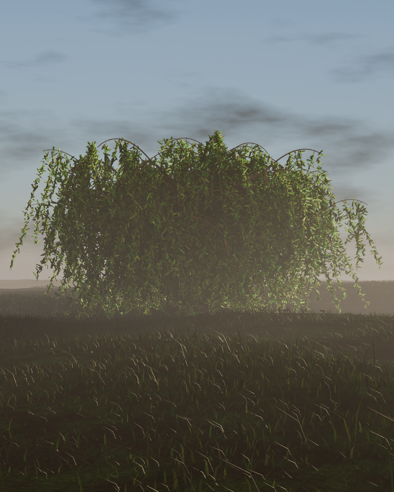

# 程序化垂柳 / Procedural Weeping Willow

多干基部、拱形主枝、21 万片狭长柳叶组成的垂帘



三棵树（阔叶树 / 垂柳 / 欧洲赤松）均由纯 Python 脚本在 Blender 中程序化生成，
**没有任何外部贴图、扫描资产或手工建模**。仓库同时提供生成脚本与成品 `.blend`，
可一键复现完全相同的场景。

---

## 这个仓库里有什么

```
model/willow_tree.blend      完整场景工程（Blender 5.2，Cycles，含材质/灯光/三个机位）
renders/               成品渲染图
scripts/               生成脚本（可参数化复现）
LICENSE                MIT
```

## 场景规格

| 项目 | 数值 |
| --- | --- |
| 树高 | 6.0 m |
| 冠幅 | 9.0 m |
| 网格对象 | 6 个 |
| 场景总顶点数 | 6,154,711 |
| `Forest_Floor` | 90,601 |
| `Grass` | 3,434,394 |
| `Litter` | 84,000 |
| `MistVolume` | 8 |
| `Willow_Bark` | 440,368 |
| `Willow_Leaves` | 2,105,340 |

## 复现方法

需要 **Blender 5.2 或更新版本**（在 [blender.org](https://www.blender.org/download/) 下载）。
无需任何 Python 第三方库，脚本只用 `bpy` 与 `mathutils`。

```bash
# 生成场景并写出 .blend
blender --background --factory-startup \
        --python scripts/build_willow.py -- \
        --rw 2000 --rh 2500 --spp 256 --cam hero --out ./out

# 从已有 .blend 批量出图（hero / trunk / canopy 三个机位）
blender --background out/willow_tree.blend \
        --python scripts/render_all.py -- --out ./renders --rw 2000 --rh 2500 --spp 256
```

### 常用参数

| 参数 | 含义 | 默认 |
| --- | --- | --- |
| `--seed` | 随机种子，決定整棵树的形态 | 各树不同 |
| `--rw` / `--rh` | 渲染分辨率 | 2000 / 2500 |
| `--spp` | 采样数 | 256 |
| `--cam` | `hero` / `trunk` / `canopy` | `hero` |
| `--nomist` | 关闭体积雾 | 关闭雾时加上 |
| `--norender` | 只建模存盘，不渲染 | — |

## 实现要点

### 结构

5 根倾斜主干自共享根盘分出，主枝先拱起再翻转下垂，1,400 余条垂枝自次级枝与主枝
外段垂挂而下，形成连续"流苏"。另有 10 根内层骨架枝用于填实冠心。

### 叶片

狭长披针形，宽长比 0.165–0.22，最宽处在叶长 28% 处，带中脉隆起、5 对侧脉、
轻微扭转。共 210,534 片，每片 20 顶点。

> 踩坑记录：垂枝路径必须按每米 30 点采样。若路径分辨率低于叶距，一根 2 m 垂枝
> 物理上只能挂 9 片叶——密度瓶颈从来不在叶子数，而在枝条采样率。

### 冠顶

主枝抬升角压到 34°、上限高度 7.7 m，垂枝起点提前到主枝 15% 处，
避免拱出的褐色主枝裸露在叶幕之上。

## 渲染

- 引擎：Cycles，AgX 色彩变换 + Punchy 观感
- 光照：低角度暖色太阳（逆光，制造叶缘透光）、冷色天空补光、地面反弹光、有界体积雾
- 硬件：CPU 即可渲染；脚本会自动探测 `HIP`(AMD) / `CUDA`(NVIDIA) / `ONEAPI` 并启用 GPU
  （开发时在一张 RX 7900 XT 上比 CPU 快约 8.5 倍）

## 许可

MIT，见 [LICENSE](LICENSE)。
`model/*.blend` 使用 [Git LFS](https://git-lfs.github.com/) 存储——Blender 场景文件
通常超过 GitHub 单文件 100 MB 硬上限。克隆前请确保已安装 Git LFS：

```bash
git lfs install
git clone https://github.com/Tudor1713/blender-tree-willow.git
```

## 致谢

本项目使用 [Blender](https://www.blender.org/)（GPL）创作，场景文件按 MIT 授权发布。
